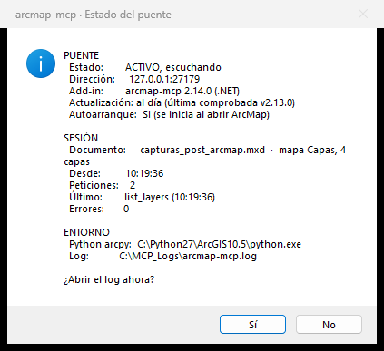
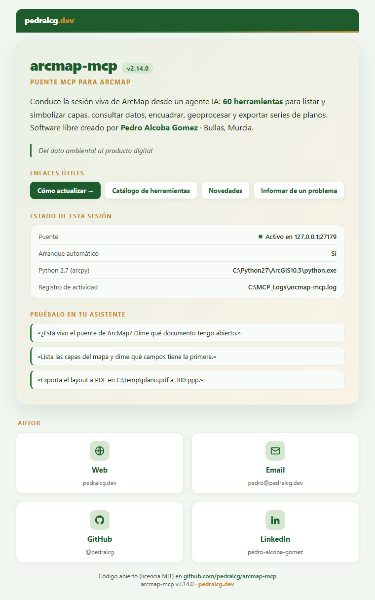

# arcmap-mcp

**ArcMap 10.5–10.8** 的本地 MCP 服务器（已在 10.5 上验证）。完全开源、自由、自主可控。
它让 AI agent（Claude Code、Claude Desktop、Gemini CLI、Antigravity、OpenCode……）能够
驾驶一个**活着的 ArcMap 会话**——列出图层、执行 arcpy、缩放定位、设置符号系统、导出
成批平面图，并**看到画布**——与 QGIS 和 ArcGIS Pro 的 MCP 所做的一样，但面向的是
legacy 的 ArcMap（那些 MCP 都不覆盖它）。

## 架构（活会话，两个部件）

```
AI 客户端（Claude Code / Desktop / Gemini / Antigravity / OpenCode）
        │  MCP 协议（stdio）
        ▼
arcmap_mcp_server.py        ← 外部 MCP 服务器（Python 3 + FastMCP）：78 个工具的
        │                     schema，以及与客户端的契约
        │  本地 TCP socket  127.0.0.1:27179
        ▼
.NET Add-in（C#）           ← 位于 ArcMap 内部：TcpListener + 原生 ArcObjects
  ├─ ArcMap 的 STA 线程     ← 图层、版面、导出、渲染（可用 ESC 取消）
  └─ Python 2.7 子进程      ← 基于 .mxd 快照的进程外 arcpy
        │                    （execute_arcpy、数据驱动页面、环境分析）
        ▼
ArcMap 打开且活着  →  画布、图层、版面、导出
```

两部件的模式——外部 MCP 服务器 + GIS 内部通过本地 socket 讲一个极简协议的桥——
取自 [QGIS 的 MCP](https://github.com/jjsantos01/qgis_mcp)（开源），是该类项目事实上的
标准。功归其主：本项目沿用该设计，并把它带到 ArcMap。

**这两个部件是设计决策，不是临时方案**：

- **.NET add-in** 跑在 ArcMap 内部，通过 ArcObjects 操作**活着的**文档（由 CLR 托管的
  COM——稳定，无需手写 interop）。每次连接在 27179 端口处理一条命令；会改动地图的操作在
  ArcMap 的 STA 线程执行（这是 ArcObjects 唯一合法的线程），而纯 arcpy 的部分则委派给一个
  **独立的 Python 2.7 进程**，它在一份临时文档副本上工作——这样长时间分析**不会冻结
  ArcMap 界面**。
- **外部服务器**通过 stdio 暴露 `@mcp.tool()`——这是所有 MCP 客户端都支持的传输方式——
  并把每条命令经本地 TCP 转发出去。从 add-in 自身直接提供 HTTP 服务曾被评估并否决：
  .NET Framework 4.5 没有 MCP SDK，`HttpListener` 需要管理员权限做 URL ACL 保留
  （会破坏一键安装），而 stdio 客户端无论如何都得要一个代理。

## 仓库结构

```
arcmap-mcp/
├── src/      arcmap_mcp_server.py   ← MCP 服务器（在你的 AI 客户端里注册它）
│             auditor_mxd.py · exportar_mxd.py ← audit_folder 与 export_mxd_lote 的 Py2.7 子进程
├── addin/    ArcmapMcp.AddIn/       ← add-in 的 C# 代码（+ 内嵌的 runner.py）
│             ArcmapMcp.Disco/       ← arcmap-mcp-disco.exe：edit_mxd_lote 与 compare_mxd 的磁盘模式
│             dist/arcmap-mcp.esriaddin  ← 可直接安装的 add-in（内含上述 .exe）
│             build.ps1              ← 不依赖 Visual Studio 的构建（dotnet CLI）
├── docs/     INSTALL.md · TOOLS.md · ROADMAP.md · img/（截图）
├── tests/    test_client_protocol.py  ← 自动化测试（不需要 ArcMap）
│             test_runner_py27.py      ← Python 2.7 下的 runner 与 auditor，不含 arcpy
│             regresion_sesion_viva.py ← 对活 ArcMap 的手工全量回归
│             regresion_ddp.py         ← 图集（数据驱动页面）回归，只读
│             regresion_disco.py       ← 针对真实 .mxd 副本跑 edit_mxd_lote（磁盘模式）
│             sonda_puente.py          ← 对单条命令的手工探针
├── INSTALAR.bat · ACTUALIZAR.bat · install.ps1 · LEEME.txt ← 一键安装
├── start-arcmap-mcp.ps1 · empaquetar.ps1 · requirements.txt · CHANGELOG.md · LICENSE · README.md
```

| 部件 | 运行位置 | 是什么 |
|---|---|---|
| `addin/dist/arcmap-mcp.esriaddin` | **ArcMap 内部**（.NET/CLR） | add-in：socket + ArcObjects + arcpy 子进程 |
| `src/arcmap_mcp_server.py` | 外部（Python 3） | 你在 AI 客户端里注册的 MCP 服务器 |
| `start-arcmap-mcp.ps1` | Windows | 启动器：准备 venv、监视隧道、做 ping |
| `arcmap-mcp-disco.exe` | 外部，ArcMap 之外 | 磁盘模式：用 add-in 的同一套 handler 应用（`edit_mxd_lote`）或读取（`compare_mxd`）`.mxd`，无需在 ArcMap 中打开。**它随 `.esriaddin` 一起分发**：不需要单独安装任何东西 |

> **arcmap-mcp 安装在 `C:\mcp\arcmap-mcp`**，无论你把 ZIP 解压到哪里：安装器会把包复制到
> 那里，并在你的 AI 客户端里注册该路径，所以解压 ZIP 的那个文件夹之后可以删掉。
> 要装到别处，用 `INSTALAR.bat -Destino D:\other\folder`（避开 Drive/Dropbox 之类的
> 同步文件夹）。如果用 git 克隆，则使用克隆所在的文件夹。

## MCP 工具

ArcMap 10.5 上的 **78 个工具**（完整的函数签名、示例以及各组执行细节见 `docs/TOOLS.md`）。

「已验证」是什么意思，这一点值得说清楚：

- `tests/regresion_sesion_viva.py` 对**真实 ArcMap 会话做 480 项检查**，覆盖 78 个工具中的
  **56 个**，含各自的错误场景。🔴 **它会修改打开的文档**（添加图层、改符号系统、跑地理
  处理）：请对测试用 mxd 运行，绝不要对生产项目运行。
- `tests/regresion_ddp.py` 覆盖图集（数据驱动页面）的三个工具，共 **14 项检查**，且对文档
  **只读**：需要一个启用了图集的 mxd，实践中这总是生产文档。导出到 `C:\temp`。
- `tests/regresion_disco.py` 用**50 项检查**针对真实 .mxd 的副本测试 `edit_mxd_lote`，每项都
  带对照（保存下来的内容由另一进程用 arcpy 读回；保存时丢失的相对路径必须报为未验证）。
- 另有 **199 个测试**无需 ArcMap 即可运行（协议、参数、.mxd 与 Word 读取器、Python 2.7
  runner、安装器）。
- `export_mxd_lote` 不经过桥，也不在回归范围内：它在真实平面图上验证过，输出与手工导出
  逐字节一致。
- 其余工具是在各个版本的真实工作中**手工**跑过的——数十页的成批平面图、环境分析——但
  **不在自动化回归里**，所以它们的故障在暴露出来之前无人发现。

这不是一句例行免责声明。2026-09-21，当首次覆盖 **geodatabase** 并在**同一会话中跑了两遍**
回归时，暴露出一个从更早版本就存在的缺陷：workspace factories 无法再被实例化，
`add_layer`、`describe_data` 和 `list_feature_classes` 随之失效，直到重启 ArcMap。
该缺陷已在 2.12.0 修复并纳入覆盖。尚未覆盖的部分，仍然是最可能藏下一个意外的地方：
如果你用的是 2.12.0 之前的版本，该缺陷仍然潜伏着。

- **无需打开 ArcMap**（从磁盘读取，不经过桥）：`describe_mxd`
  （不打开 .mxd 就读出它声明的版本，毫秒级）· **`audit_folder`**
  （为整个文件夹里所有 .mxd 建清单：版本、图层、失效数据源和
  definition query，每个文档都在独立进程中打开并带超时）·
  `get_ole_tables`（嵌在 .mxd 里的 Word 表格，直接从文件中读取）。

- **核心工具：** `ping` · `get_arcmap_info` · `list_layers` · `zoom_to_layer` ·
  `export_pdf` · `refresh` · **`execute_arcpy`**（在文档快照上执行任意 arcpy
  代码——细节见 `docs/TOOLS.md`）。
- **成批平面图（数据驱动页面）：** `list_ddp` · `export_ddp` ·
  `list_layout_elements` · `set_text_element` · `goto_ddp_page` · `set_definition_query` ·
  `set_layer_visibility` · `export_view_png` · `export_jpg` · **`export_mxd_lote`**
  （导出磁盘上的一组 .mxd，每个文档一个进程：成批出图的通路）。
- **图层与数据：** `select_by_attribute` · `clear_selection` · `get_unique_values` ·
  `count_features` · `list_fields` · `get_layer_info` · `get_layer_features` · `add_layer`
  （也支持 **WMS 服务**，以及不进图例的图层）· `remove_layer` ·
  `apply_symbology_from_layer` · `set_scale`。
- **目录树与图例：** `add_group`（空的分组图层）· `move_layer`
  （重新安置图层或分组而不移除它）· `rename_layer`（改名而不替换）
  · `set_legend_item`（控制图层在图例条目里显示什么，不改其外观；
  移除或移动它）· `set_legend`（字号、列数，以及把图例塞进框内而不缩放）。
- **符号系统：** `set_graduated_symbology`（分级，要素图层）·
  **`set_unique_values_symbology`**（按唯一值分类）·
  **`set_raster_symbology`**（栅格分级、拉伸或**按唯一值**——
  NDVI、FCC、P95、坡度，以及带透明值的分类掩膜）·
  `set_single_symbology`（用指定颜色渲染单一符号）· **`edit_symbol`**
  （只改图层现有符号系统中被要求的部分）· `list_style_symbols` /
  `apply_style_symbol`（按名称使用你 `.style` 样式中的符号）·
  `apply_symbology_from_layer`（.lyr 模板）。
- **标注：** **`set_labels`**（表达式、字号、颜色和晕圈；返回每个类别的最终状态，
  以及地图用的是 Maplex 还是标准引擎）。
- **空间书签：** `get_bookmarks` · `add_bookmark` · `remove_bookmark` ·
  `goto_bookmark`。
- **地理处理与维护：** `run_geoprocessing` · `save_mxd` · `save_mxd_as` · `open_mxd` ·
  `list_broken_data_sources` · `repair_data_source`。
- **可视化与目录：** **`get_canvas_screenshot`**（内联返回图片，agent
  能看见地图；可用 ESC 取消）· `describe_data` · `list_data_frames` / `set_active_df` ·
  `set_extent` · `get_workspace` / `set_workspace` · `list_feature_classes` /
  `list_tables` / `list_rasters`。
- **环境分析与遥感**（需 Spatial/3D Analyst；在 ArcMap 进程之外运行 →
  **不会冻结 GUI**）：**`raster_index`**（具名光谱指数：
  NDVI、GNDVI、NDRE、NDWI、MNDWI、NDMI、NBR、SAVI、EVI——含
  Sentinel-2 / Landsat 波段映射）· `hydrology`（流域、河网、
  淹没区）· `contours` · `topographic_profile` · `least_cost_path` ·
  `calculate_geometry`。

设计哲学是**混合式**的：`execute_arcpy` 是通用底座（ArcMap 10.x 的任何分析都能用它
表达），而封装工具只针对重复且高价值的场景存在。

### 快速上手：5 步做出你的第一张平面图

装好 add-in、并在 AI 客户端里注册好服务器之后，这就是从「什么都没碰」到「拿到一张 PNG」
的短路径。用平常的语言向 agent 提要求即可；括号里是它最终会用到的工具。

1. **打开 ArcMap 并点击 arcmap-mcp 工具条上的 *Iniciar*（启动）。** 这是唯一的手动步骤，
   没有它就没有桥。
2. **「桥活着吗？」**（`ping`）。它应返回 add-in 版本、打开的文档和图层数量。如果返回
   `PUENTE CAIDO`（桥已断开），回到第 1 步；如果返回 `ocupado`（忙），说明 ArcMap 正在
   做事，它会告诉你做什么、从何时开始。
3. **「加上这个图层，告诉我里面有什么」**（`add_layer`、`list_layers`、
   `list_fields`）。从这里开始，agent 就了解你的数据及其字段了。
4. **「给它设符号系统并缩放定位」**（分级用 `set_graduated_symbology`，
   分类用 `set_unique_values_symbology`，栅格用 `set_raster_symbology`；
   然后用 `zoom_to_layer`）。
5. **「把视图导给我」**（`export_view_png`，或版面用 `export_pdf`）。如果想不离开对话
   就看到结果，用 `get_canvas_screenshot` 内联返回图片。

两个从第一天起就能省掉麻烦的捷径。如果要处理不认识的 .mxd，先跑 `describe_mxd` 或
`audit_folder`：它们**不打开**文件就能读取，因此能一次告诉你整个文件夹的版本、图层和失效
数据源，而不会有卡在数据源已断的文档上干等的风险。当你找到一个要反复使用的取景范围，
用 `add_bookmark` 存起来，之后用 `goto_bookmark` 回去。

## 安装

### 开始之前

| 你需要 | 说明 |
|---|---|
| **ArcMap 10.5–10.8** | 已在 10.5 验证，并有用户在 **10.8**（build 12790）上确认可用。10.6 和 10.7 应该能跑，但尚无确认：见 [ArcMap 版本](#arcmap-版本)。 |
| **Python 3.10 或更高** | 用于 MCP 服务器。**你可能已经装了**：安装器也会查找 QGIS 和 ArcGIS Pro 自带的那份，即使它们不在 PATH 里。如果一份都找不到，会提议用 `winget` 安装，或由你从 [python.org](https://www.python.org/downloads/windows/) 下载。 |
| **ArcGIS 的 Python 2.7** | **无需安装**：它随 ArcMap 一起提供（`C:\Python27\ArcGIS10.x`）。arcpy 分析和数据驱动页面都用它。 |
| **一个 MCP 客户端** | Claude Desktop、Claude Code、Gemini CLI、Antigravity 或 OpenCode。 |
| **网络连接** | 仅在安装期间需要，用于下载服务器的依赖。 |

### 1. 下载

**不用 git**（如果你不用 git，推荐这种方式）：在仓库页面点击绿色按钮
**Code ▸ Download ZIP**。解压之前，**右键点击 ZIP ▸ 属性 ▸ 勾选「解除锁定」▸ 确定**：
Windows 会标记来自互联网的文件，该标记可能阻止 ArcMap 加载 add-in。然后再解压到你想要的
文件夹（比如 Downloads）：安装时它会自动复制到 `C:\mcp\arcmap-mcp`。

**用 git：**

```powershell
git clone https://github.com/pedralcg/arcmap-mcp.git C:\mcp\arcmap-mcp
```

### 2. 安装

**关闭 ArcMap**，然后**双击 `INSTALAR.bat`**。就这样：它把 arcmap-mcp 放到
`C:\mcp\arcmap-mcp`，准备服务器环境，把 add-in 装进 ArcMap，并在你机器上找到的 AI 客户端里
注册服务器。

如果你更用终端，工作量是一样的（在你解压出来的文件夹里执行）：

```powershell
powershell -ExecutionPolicy Bypass -File .\install.ps1
```

> `-ExecutionPolicy Bypass` 是必需的，因为 Windows 出厂配置不执行 `.ps1` 脚本。
> `INSTALAR.bat` 里已经带上了。

默认配置**所有检测到的 AI 客户端**。要选择：`-Clientes claude-desktop`
（或 `claude-code`、`gemini`、`antigravity`、`opencode`、`todos`、`ninguno`）。
它是幂等的：每次更新后重复执行即可。

### 3. 启动并验证

打开 ArcMap。第一次工具条不会自动出现：在 **Customize ▸ Toolbars ▸ arcmap-mcp**
里启用它（之后 ArcMap 会记住你放置的位置）。


从左到右：**Iniciar**（启动）和 **Detener**（停止）桥、**Estado**（状态）、
**Autoarranque**（自动启动）下拉框、**Reportar**（报告问题）和 **Acerca de**（关于）。
把下拉框设为 **「Autoarranque: Sí」**（自动启动：是），桥就会在本次及之后所有会话中
自动拉起。然后：

```powershell
.\install.ps1 -SoloVerificar    # 检查安装并对桥做一次真实 ping
```

完整重启你的 AI 客户端（MCP 服务器注册表在启动时读取），然后让它调用 `ping` 工具。
要全部卸载：`.\install.ps1 -Desinstalar`。

**如果有什么不对，Status（Estado）按钮**会告诉你桥是否活动、加载的是哪个 add-in 版本
（ArcMap 里实际安装的那个，这才是算数的那个）、是否有更新的版本、本次会话已处理多少请求和
错误，以及日志在哪里：



**Acerca de**（关于）会在浏览器中打开一个卡片，含版本、会话状态、
可以向助手提什么要求的示例，以及更新或报告问题的链接：



### 4. 更新

add-in 会在有新版本时自行提示（每天查询一次仓库的 tag）。
更新方式取决于你如何下载，两种情况下都**必须关闭 ArcMap**：
它打开时会一直加载着 add-in，无法热替换。

| 你是这样下载的… | 更新方式 |
|---|---|
| **用 git** | 双击 **`ACTUALIZAR.bat`**。它执行 `git pull` 并重新安装。 |
| **ZIP** | 下载新的 ZIP，解压到任意位置并双击 **`INSTALAR.bat`**：它会更新 `C:\mcp\arcmap-mcp`。 |

不用 git 时，**你的更新器就是 `INSTALAR.bat`**：不用再记第二个文件。
`install.ps1` 是幂等的，所以第一次还是第五次都一样：它先删掉旧的 add-in 再复制新的，
刷新服务器环境并重新注册客户端。`ACTUALIZAR.bat` 只是在其前面加了 `git pull`，
如果你在没有 git 的情况下运行它，它会告诉你并且不做任何改动。

**更新 add-in 之后，`arcmap-mcp` 工具条不会自动出现。** 这是 2.8.2 起的正确行为：
在 *Customize ▸ Toolbars ▸ arcmap-mcp* 里启用一次，ArcMap 就会记住它的位置。
用 **Estado** 按钮确认版本是你期望的那个。

> MCP 服务器（Python）不需要这套仪式：它从 `C:\mcp\arcmap-mcp`（或你的 git 克隆）运行，
> 所以安装器一替换文件它就已经更新了。只有 .NET add-in 才强制要求关闭
> ArcMap。完整细节见 [`docs/INSTALL.md`](docs/INSTALL.md#actualizar)。

### ArcMap 版本

add-in 是针对 ArcMap **10.5** 编译的，并在该版本的真实使用中验证过。ArcMap
通常能加载为等于或低于所安装版本的 ArcMap 编译的 add-in，
所以在 10.6–10.8 上应该可用。**在 10.8（build 12790）上已获用户确认**，
即使安装在非标准路径也可以：add-in 能加载、桥能拉起、
活会话回归也干净通过（issue #1）。10.6 和 10.7 尚无确认：
如果你试过，请在 *issue* 里说一声。

**在 10.4 或更早版本上不能用**，安装器也不再假装可以：如果检测到这些版本，
它会说明情况并且不安装 add-in（但仍会准备服务器并注册客户端）。
清单声明 `<Target version="10.5">`，DLL 链接的是 ESRI 10.5 程序集，
所以 ArcMap 不会加载它——而且不会解释原因。要在那些版本上用，必须**重新编译**：
修改 `addin\ArcmapMcp.AddIn\Config.xml` 里的 `<Target>`，
把 `.csproj` 的引用指向你的 ESRI 程序集，然后跑 `addin\build.ps1`。

### 手动安装

如果安装器不适合你的机器，下面是等价的手工步骤
（完整细节，包括各客户端的配置，见 `docs/INSTALL.md`）。

### 1. 把 add-in 装进 ArcMap

在 **ArcMap 已关闭**的情况下，双击 `addin\dist\arcmap-mcp.esriaddin` ▸ *Install*。

如果打开 ArcMap 后 **arcmap-mcp** 工具条没出现（Esri 的安装器有时会
静默失败），可手动安装：解压/复制 `.esriaddin` 的内容
（它是个 ZIP）到
`%USERPROFILE%\Documents\ArcGIS\AddIns\Desktop10.5\{51f4ce63-6bcf-49b2-ae3a-ba2c79ea3e1a}\`
然后重新打开 ArcMap。工具条带 6 个按钮：**Iniciar / Detener / Estado / Autoarranque /
Reportar / Acerca de**。**Reportar**（报告）会打开一个预填了会话诊断信息的
GitHub issue 或邮件（不含项目数据）；而日志可能包含图层名和路径，不会自动附加。
打开 ArcMap 时，add-in 会在后台检查 GitHub 上是否有新版本，并在 **Estado** 和
**Acerca de** 中提示（没有网络时静默）。

点击 **Iniciar**（启动）→ 弹出「Puente iniciado」（桥已启动）消息框，add-in 开始监听
`127.0.0.1:27179`。add-in 把日志写到 `C:\MCP_Logs\arcmap-mcp.log`。

### 2. 拉起 / 监视隧道
```powershell
.\start-arcmap-mcp.ps1            # 准备 venv、等待桥、做 ping
.\start-arcmap-mcp.ps1 -Server    # 另外启动 MCP 服务器（独立模式）
```
启动器会一直重试直到桥出现，所以你可以在打开 ArcMap 之前就运行它：
它会给你指引，并在桥活着时自动连接。

### 3. 在你的 AI 客户端里注册
以 Claude Code 为例（项目的 `.mcp.json` 或全局配置）。把 `<USUARIO>`
替换成你的 Windows 用户名：
```json
{
  "mcpServers": {
    "arcmap": {
      "command": "C:/Users/<USUARIO>/AppData/Local/arcmap-mcp/venv/Scripts/python.exe",
      "args": ["C:/mcp/arcmap-mcp/src/arcmap_mcp_server.py"]
    }
  }
}
```
5 个客户端的完整指引见 `docs/INSTALL.md`。

### 4. 验证
桥活着时，通过 MCP 请求 `ping` 工具 → 它应返回 add-in 版本、打开的文档和图层数。
然后 `list_layers` → 你的图层。全部 OK。

## 远程访问（可选）
add-in **只在 `127.0.0.1` 上监听，这一点无法更改**：故意没有提供任何变量
或设置来放开绑定。如果 ArcMap 跑在另一台机器上，用加密隧道转发端口——SSH
（`ssh -L 27179:127.0.0.1:27179 <host>`）或 Tailscale——
MCP 服务器就能像连本地一样连上去（仅当隧道的本地端点不是 127.0.0.1 时才需要
`ARCMAP_BRIDGE_HOST`）。

隧道不是绕道：**它终止于目标机器的 `127.0.0.1`**，
因此无需对外开放任何东西就能到达这个 listener，同时顺带加密和认证，
而这正是桥所缺的。

> ⚠️ **安全。** 桥暴露了 `execute_arcpy`，也就是在托管 ArcMap 的机器上
> **执行任意 Python 代码**，没有认证、没有用户体系、
> 也没有 TLS：任何能访问该端口的人都能以打开 ArcMap 那位的权限执行任意操作。
> 回环不是一项待放开的限制，**它是唯一的屏障**，
> 因此绑定被固定下来。真正可配置的是**端口**，这不改变上述任何一点：
> 它仍然只在回环上监听。

### 更改端口：`ARCMAP_BRIDGE_PORT`
默认为 `27179`。它存在的理由很具体：当某个 ArcMap 实例变成
**僵尸**——活着、有响应，但没有主窗口——它会一直占着端口，
如果没有替代方案，任何新的 ArcMap 都无法拉起桥。有了这个变量，
你就有了一条不必杀进程的退路。

**两端用的是同一个变量**：add-in 从用户环境读取它
（要在打开 ArcMap **之前**设好），MCP 服务器则从它自己的环境或客户端配置的
`env` 块读取。如果只在一端设置，它们就找不到彼此。支持 `1024`–`65535`；
非法值会在日志中告警并被忽略，回退到 `27179`。

## 已知限制与性能

- **什么会冻结 GUI，什么不会。** 在 ArcMap **进程之外**运行的工具
  （`execute_arcpy`、数据驱动页面的 3 个工具以及环境分析）**不会
  冻结界面**：它们运行时你可以继续工作。而
  `run_geoprocessing`（原生，在 ArcMap 内部）以及导出/渲染确实会占用
  界面线程直到执行完毕——与你手动发起时完全一样。对于磁盘数据上的长时间
  地理处理，`run_geoprocessing(fuera_de_arcmap=True)` 会把它单独启动
  （固定约 10 秒的启动耗时；图层通过其数据源路径传递）。
  渲染和导出可以用 **ESC** 取消。
- **含 OLE 框架的文档（嵌入对象，例如来自 Word）。** 这是 ArcMap
  10.5 的缺陷，不是 add-in 的（没有 add-in 也一样）：OLE 框架类由 ArcMap 从它
  自己的进程提供，所以只要 ArcMap 打开着，外部加载该 `.mxd` 的 arcpy 就会一直
  等待一个永远不会返回的 ArcMap 调用（ArcMap 关闭时一秒就能打开）。
  add-in 会统计打开文档中的这类对象，凡是会在 ArcMap 之外打开副本的操作
  （带文档的 `execute_arcpy`、DDP、`save_mxd` 的校验）都会**立即拒绝**
  并说明它们在哪里；`describe_mxd` 不打开文件就能统计出来，`audit_folder` 在 ArcMap
  打开时不会去打开含这类对象的文件。它们通常位于页面之外、打印不到的地方：
  删掉即可解决问题。如果还是发生了（某个脚本打开了另一个 `.mxd`），关闭
  ArcMap 时窗口会消失但进程仍然存活：没有什么可保存的，按 PID 终止它。
- **快照语义。** 进程外工具在一份**临时 .mxd 副本**上工作，
  该副本携带会话的当前状态：它们读到的是真实文档
  （图层、definition query、图集），但**它们对文档的修改不会
  反映到活会话中**（写盘输出是真实的，分析结果会在结束时
  加到地图里）。要修改活会话，请用原生工具（`set_*`、`add_layer`……）。
  每次调用的固定开销：大约几秒（快照 + 启动 Python）。
- **含相对路径的文档。** 当文档以相对路径保存其数据源时，临时副本会**放在
  .mxd 旁边**而不是 `%TEMP%` 中：带到另一个文件夹，
  那些路径就不再能解析，快照打开时所有图层都会是断的。因此在调用期间，
  你的文档旁边可能出现一个隐藏文件
  `~arcmap-mcp-snap_*.mxd`；结束时它会被删除，如果真有一个成了孤儿，
  文件名会说明它来自哪里。
- **大型图集：** 对数百页的图集执行 `export_ddp` 即使超时放得很宽也可能耗尽
  等待时间；请按 `valores` 列表或 `rango` 分批导出
  （分多次调用），这样还能按批得到反馈。（没有 `paginas` 参数：
  签名是 `export_ddp(salida, modo, rango, valores, un_pdf_por_pagina, dpi)`。）
- **超时。** 没有单一超时：服务器上有五个，每个覆盖 add-in
  以相同方式处理的那一组工具。

  | 变量（服务器端） | 默认值 | 覆盖范围 |
  |---|---|---|
  | `ARCMAP_BRIDGE_TIMEOUT` | 60 s | 快速工具：查询、图层、符号系统、导航 |
  | `ARCMAP_GP_TIMEOUT` | 1860 s | 占用 ArcMap 线程的操作：`run_geoprocessing`、`calculate_geometry`、`export_pdf`、`export_jpg`、`export_view_png` |
  | `ARCMAP_FONDO_TIMEOUT` | 2760 s | 走后台 handler 的操作：数据驱动页面的 3 个和环境分析的 5 个 |
  | `ARCMAP_SAVE_TIMEOUT` | 630 s | `save_mxd`、`save_mxd_as` 和 `open_mxd` |
  | `ARCMAP_EXEC_TIMEOUT_CLIENTE` | 930 s | **仅 `execute_arcpy`** |
  | `ARCMAP_EXEC_SESION_TIMEOUT_CLIENTE` | 1560 s | 带 `serializar_sesion=True` 的 `execute_arcpy`：add-in 在其 900 s 之前要花多达 600 s 复制会话 |
  | `ARCMAP_ESPERA_DIBUJO` | 120 s | 三个导出工具在到达时地图**仍在绘制**的情况下（E_PENDING，在刚改过视图或标注后很常见）：服务器在 ArcMap 之外等待，每 3 s 重试一次 |

  `execute_arcpy` **不**走 `ARCMAP_GP_TIMEOUT`：调高那个变量在那里不会延长任何东西，
  这是最费时间的那个误解。

  服务器的每个等待都**高于** add-in 对同一工作施加的上限（`ARCMAP_EXEC_TIMEOUT`
  900 s、`ARCMAP_SUBPROCESS_TIMEOUT` 1800 s，加上 ArcMap 线程内部的 1800 s 上限和
  后台 handler 的 2700 s）。这是有意为之：这样 add-in 的那一个先到期，它会杀掉子进程
  并返回一个说明卡在哪个阶段的错误，而不是一次沉默的 socket 中断，留下孤儿 runner
  （而孤儿 runner 会阻止关闭 ArcMap）。另外，你的 AI 客户端可能有它自己的 MCP 工具
  超时，通常比这些全都短。

  **在哪里定义它们，这一点不可互换。** 服务器端的那些，放在客户端 MCP 配置的 `env`
  块里。add-in 的那些（`ARCMAP_EXEC_TIMEOUT`、
  `ARCMAP_SUBPROCESS_TIMEOUT`、`ARCMAP_PYTHON27`），要设为 **Windows 用户级
  环境变量，且在打开 ArcMap 之前**：add-in 跑在 ArcMap 进程里，它看不到 MCP 客户端
  `env` 的任何内容——放在那里绝对不起作用。
- **扩展模块。** `raster_index`、`hydrology`、`least_cost_path` 需要 **Spatial
  Analyst**；`contours`、`topographic_profile` 需要 **3D Analyst**（在
  *Customize ▸ Extensions* 中启用）。缺少许可时，工具会返回明确的错误。
- **每次连接一条命令，串行。** 桥一次处理一条命令；如果在它工作时又来一条，
  会立即返回 `busy`（不排队）。
- **桥活在一个 ArcMap 实例里，而且只看得到那一个。** add-in **会加载到
  所有窗口**；唯一的是**端口**（`27179`），所以哪个 ArcMap 先点了 *Iniciar* 就由它
  占住，其他窗口里桥不会起来（日志里会记录，不影响其他功能）。一个容易迷惑的
  实际后果：打开十个 ArcMap 时，`get_arcmap_info` 只返回**一个**文档，这不是 bug 也不是
  ArcMap 的限制，而是另外九个对服务器不可见。如果你期待的是另一个文档，
  说明桥在另一个窗口里。尽可能只用一个实例工作。从 **2.10.0** 起，
  `ARCMAP_BRIDGE_PORT`（在打开那个 ArcMap 之前定义）允许在另一个端口上拉起第二个
  桥——它也是当一个已无响应的 ArcMap 占着 `27179` 时的退路。
- **workspace 是按会话的。** `set_workspace` 设置 add-in 的 workspace（不存在
  持久的 `arcpy.env`）；重启 ArcMap 后会被重置。

## 状态
- [x] 原生 .NET add-in（通过 CLR 使用 ArcObjects，无内嵌 Python 运行时）
- [x] 78 个工具，包括环境分析（光谱指数、水文、
      等高线、3D 剖面与最小成本路径）以及真实的数十页成批平面图。
      自动化覆盖：56 个工具的活会话 480 项检查、磁盘模式 50 项检查，
      以及 199 个无需 ArcMap 的测试（见「MCP 工具」）
- [x] arcpy 地理处理在进程外：ArcMap 的 GUI 不会冻结
- [x] 用 ESC 取消渲染/导出（`ITrackCancel`）
- [x] 可在 5 个客户端中注册（Claude Code/Desktop、Gemini CLI、Antigravity、OpenCode）

## 许可与贡献

本项目**自由且开放**（MIT）：你可以免费使用、修改和部署。
它面向那些仍受限于 ArcMap 10.x、又希望用 AI agent 自动化制图工作
而不必等迁移到 ArcGIS Pro 的组织。

疑问、缺陷和提议请走仓库的 **Issues**。

## 社区资源

- [arcmap-mcp-skill](https://github.com/HeyElowen/arcmap-mcp-skill)，作者
  [@HeyElowen](https://github.com/HeyElowen)：一个供使用
  arcmap-mcp 的 agent 使用的 skill（MIT，README 有中文、英文和西班牙文）。它是其作者的项目，
  不属于 arcmap-mcp。

## 致谢

- 架构模式：[qgis_mcp](https://github.com/jjsantos01/qgis_mcp)（Juan
  Santos），开源的 QGIS MCP。
- MIT — © 2026 Pedro Alcoba Gómez · [pedralcg.dev](https://pedralcg.dev) · GitHub
  [@pedralcg](https://github.com/pedralcg)
